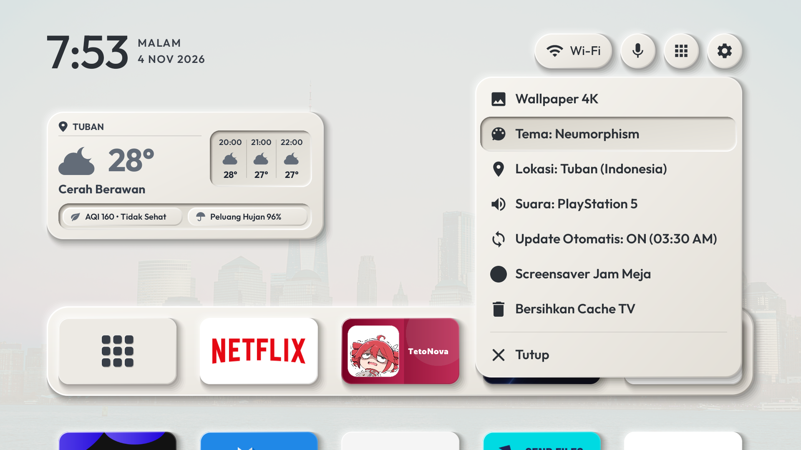
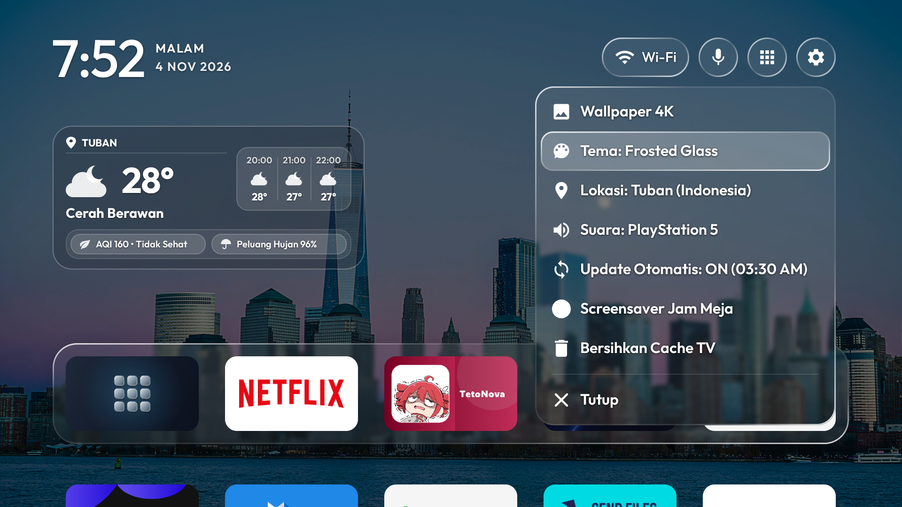
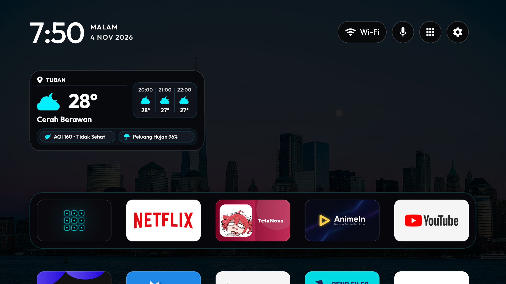

<div align="center">

# 📺 Aura TV Home

**Launcher Android TV / STB yang Cepat, Modern, Bersih, dan Elegan**  
*Mendukung Tema Frosted Glass, Neumorphism, dan Dark Glow dengan Widget Cuaca Presisi & Navigasi Remote Halus.*

[](https://github.com/luthpunk/aura-tv-home/actions/workflows/build-apk.yml)
[](https://github.com/luthpunk/aura-tv-home/releases/latest)
[](#)
[](LICENSE)

[**📥 Unduh APK Terbaru (aura-tv-home.apk)**](https://github.com/luthpunk/aura-tv-home/releases/latest/download/aura-tv-home.apk) • [**Fitur**](#-fitur-utama) • [**Tampilan Layar**](#-tampilan-layar-tema) • [**Pemasangan**](#-cara-pemasangan-di-android-tv--stb) • [**Pembaruan OTA**](#-pembaruan-otomatis-ota) • [**Kredit & Lisensi**](#-kredit--lisensi)

---

</div>

## 🖼️ Tampilan Layar (Tema)

Aura TV Home menyediakan 3 pilihan gaya visual modern yang dapat diubah langsung dari menu **Setelan**:

### 1. Neumorphism
Gaya desain *soft UI* modern dengan bayangan timbul dan cekung halus yang nyaman dipandang.


### 2. Frosted Glass
Tampilan kaca buram (*acrylic blur*) premium ala Apple TV dengan efek kilau pencahayaan ambient dinamis.


### 3. Dark Glow
Tema gelap dengan aksen kontras neon cyber minimalis dan teks putih bersih yang hemat energi pada layar TV.


---

## ✨ Fitur Utama

- **🚀 Ringan & Cepat:** Dioptimalkan khusus untuk chipset prosesor STB/Android TV (Amlogic, Allwinner, Rockchip) agar perpindahan aplikasi dan respon remote terasa instan tanpa jeda (*zero stutter*).
- **🎵 Dynamic Now Playing Pill (Pemutar Musik Kapsul):**
  - Kapsul status dinamis setinggi 42dp yang sejajar dengan bilah menu atas (hanya muncul saat musik diputar).
  - Menampilkan cover album asli, judul lagu berjalan (*marquee*), nama artis, serta tombol kontrol instan `[ ⏯ Play/Pause ]` dan `[ ⏭ Next ]`.
  - Mendukung berbagai pemutar musik & media (Spotify TV, YouTube TV, SmartTube, Apple Music, VLC, pemutar lagu lokal USB, dll).
  - Tampilan beradaptasi 100% mengikuti tema aktif (*Frosted Glass*, *Neumorphism*, dan *Dark Glow*).
- **🌤️ Widget Cuaca Kompak & Presisi:**
  - Menampilkan lokasi, suhu besar, ikon vektor cuaca, dan kondisi cuaca saat ini (*flush left*).
  - **Slot Ramalan 3 Jam ke Depan:** Memantau ramalan cuaca pada rentang waktu `+3 jam`, `+6 jam`, dan `+9 jam` secara akurat dari Open-Meteo.
  - Dua pil informasi di bagian bawah: **AQI (Indeks Kualitas Udara)** dan **Peluang Hujan (%)**.
  - Posisi widget terkunci statis tepat di tengah antara Jam dan Nama Aplikasi Baris 1 tanpa bergeser (*no drift*).
- **🎨 3 Tema Visual:** **Frosted Glass**, **Neumorphism**, dan **Dark Glow**.
- **🧭 Navigasi D-Pad Remote Halus:** Animasi fokus *Glider* yang presisi mengalir di antara kartu aplikasi dan tombol menu atas.
- **🔄 Pembaruan Langsung di TV (OTA Update):** Pengecekan otomatis versi baru langsung dari repositori GitHub ini. Cukup tekan tombol update di TV dan APK akan terinstal langsung.
- **🛠️ Pengaturan Fleksibel:** Pengaturan baris dan kolom aplikasi, sembunyikan/tampilkan aplikasi tertentu, ganti wallpaper dinamis online/lokal, serta kustomisasi tata letak.

---

## 📥 Cara Pemasangan di Android TV / STB

Unduh file APK rilis terbaru:  
👉 **[Unduh aura-tv-home.apk](https://github.com/luthpunk/aura-tv-home/releases/latest/download/aura-tv-home.apk)**

### Metode 1: 1-Klik Otomatis Lewat Tab Boost di Aura TV Tools (Sangat Direkomendasikan ⭐)
Tidak perlu mengunduh file APK manual atau mengetik perintah terminal. Anda cukup menggunakan aplikasi pendamping [**Aura TV Tools**](https://github.com/luthpunk/aura-tv-tools) dari ponsel Android Anda:

1. Pasang & buka aplikasi [**Aura TV Tools**](https://github.com/luthpunk/aura-tv-tools) di ponsel Android Anda.
2. Sambungkan ke Android TV / STB Anda (pilih TV dari daftar pencarian Wi-Fi otomatis atau masukkan IP TV).
3. Masuk ke tab **🚀 Boost TV**.
4. Pada kartu **Aura TV Home**, tekan tombol **"Pasang Aura TV Home"**.
5. **Selesai secara otomatis!** Aplikasi Aura TV Tools akan langsung:
   - Mengunduh file APK versi rilis terbaru `aura-tv-home.apk` dari repositori GitHub ini.
   - Mengirim dan memasang APK ke TV / STB melalui jalur nirkabel ADB.
   - Menetapkan Aura TV Home sebagai launcher beranda utama default (`set-home-activity` & role Home).
   - Memberikan izin sistem aman (`WRITE_SECURE_SETTINGS`).
   - Membuka dan menampilkan Aura TV Home langsung di layar TV Anda.
   *(Jika suatu saat Anda ingin kembali ke launcher bawaan pabrik TV, cukup klik tombol "Pulihkan launcher bawaan" pada menu yang sama).*

---

### Metode 2: Pasang Manual Lewat Tab Aplikasi di Aura TV Tools
Jika Anda telah mengunduh file APK ke ponsel dan ingin memasangnya secara manual:
1. Buka [**Aura TV Tools**](https://github.com/luthpunk/aura-tv-tools) dan sambungkan ke TV.
2. Masuk ke tab **Aplikasi** > klik tombol **＋ Pasang APK dari ponsel**.
3. Pilih file `aura-tv-home.apk` yang tersimpan di memori ponsel.
4. Tekan tombol **Home** pada remote TV, pilih **Aura TV Home**, lalu pilih **"Selalu" (Always)**.

---

### Metode 3: Lewat ADB (PC / Laptop / Termux / Terminal)

Jika tombol Home di remote STB Anda dikunci oleh launcher bawaan pabrik (seperti launcher IndiHome, Android TV Core, atau Google TV Launcher), Anda bisa menjadikannya default permanen lewat ADB:

1. **Instal APK ke STB:**
   ```bash
   adb connect <IP_STB>:5555
   adb install -r aura-tv-home.apk
   ```

2. **Jadikan Default Langsung Lewat Perintah:**
   ```bash
   # Buka Aura TV Home langsung ke layar
   adb shell cmd package set-home-activity com.gathin.tvhome/.MainActivity
   ```

3. **(Opsional) Nonaktifkan Launcher Bawaan STB jika Masih Muncul:**
   Jika tombol Home masih kembali ke launcher pabrik, nonaktifkan launcher bawaannya (bisa diaktifkan kembali kapan saja):

   - **Android TV / Google TV Standar:**
     ```bash
     adb shell pm disable-user --user 0 com.google.android.tvlauncher
     # Atau untuk Google TV UI baru:
     adb shell pm disable-user --user 0 com.google.android.apps.tv.launcherx
     ```
   - **STB Operator (ZTE / Fiberhome / IndiHome):**
     ```bash
     adb shell pm disable-user --user 0 com.zte.iptvclient.android.launcher
     # Atau:
     adb shell pm disable-user --user 0 com.fiberhome.myindihome
     ```

   *(Untuk mengaktifkannya kembali jika sewaktu-waktu dibutuhkan, cukup ganti kata `disable-user --user 0` menjadi `enable`).*

4. **⚡ Aktifkan Izin Pemutar Musik (Now Playing) via ADB:**
   Pada sistem Android TV / Google TV, Google menyembunyikan menu pengaturan izin notifikasi dari antarmuka TV Leanback. Agar launcher dapat membaca judul lagu, nama artis, dan cover album secara otomatis, jalankan perintah ini sekali setelah pemasangan (sangat disarankan dieksekusi langsung oleh **Agen AI** atau melalui terminal ADB):

   ```bash
   # Aktifkan izin listener musik ke sistem Android TV
   adb shell cmd notification allow_listener com.gathin.tvhome/com.gathin.tvhome.MediaNotificationListener

   # (Opsional) Berikan izin pengelolaan setelan aman agar tersinkronisasi
   adb shell pm grant com.gathin.tvhome android.permission.WRITE_SECURE_SETTINGS
   ```
   > 💡 **Untuk Agen AI / Skrip Otomatisasi:** Cukup jalankan perintah di atas tepat setelah perintah `adb install -r aura-tv-home.apk` agar fitur Now Playing langsung aktif dan siap digunakan seketika tanpa perlu konfigurasi manual.

---

## 🔄 Pembaruan Otomatis (OTA)

Aura TV Home memiliki modul pembaruan in-app terintegrasi. Metadata versi rilis tersimpan pada:
```
https://raw.githubusercontent.com/luthpunk/aura-tv-home/main/release/version.json
```
Setiap kali rilis baru diterbitkan di repositori ini, pengguna akan mendapatkan notifikasi pembaruan langsung di layar TV.

---

## 📜 Kredit & Lisensi

Proyek ini dibangun dan dikembangkan dengan basis fondasi utama dari repositori open-source:
- **Basis Proyek Utama:** [**CleanYourTV**](https://github.com/Gathin23/cleanyourtv) oleh **Gathin23**  
  *Terima kasih yang sebesar-besarnya kepada pengembang asli atas arsitektur launcher Android TV yang luar biasa.*

### 🛠️ Pustaka & Aset Pihak Ketiga Lainnya:
- **Prakiraan Cuaca:** [Open-Meteo API](https://open-meteo.com/) *(Non-komersial, lisensi terbuka)*.
- **Kualitas Udara:** Data APIMS / JAS Malaysia & Open-Meteo Air Quality.
- **Tipografi:** Font [Outfit](https://fonts.google.com/specimen/Outfit) oleh Rodrigo Fuenzalida & Omnibus-Type *(SIL Open Font License 1.1)*.
- **Ikonografi:** Google Material Icons & Komponen Vektor SVG berlisensi Apache 2.0.

### 📄 Lisensi
Perangkat lunak ini dirilis di bawah lisensi **Apache License 2.0**. Lihat file [LICENSE](LICENSE) untuk rincian selengkapnya.
